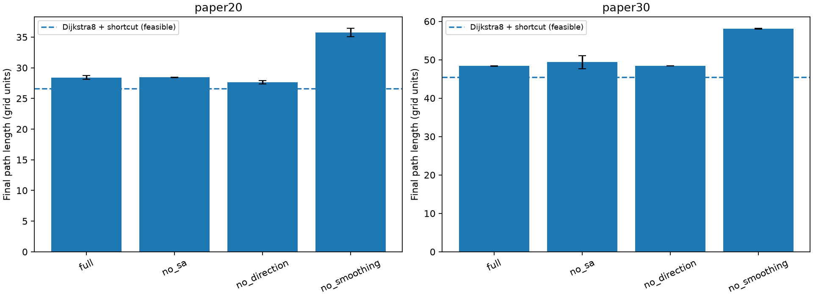
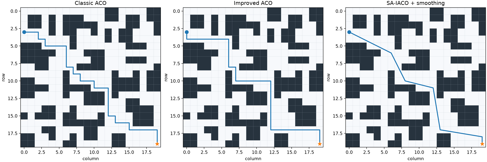
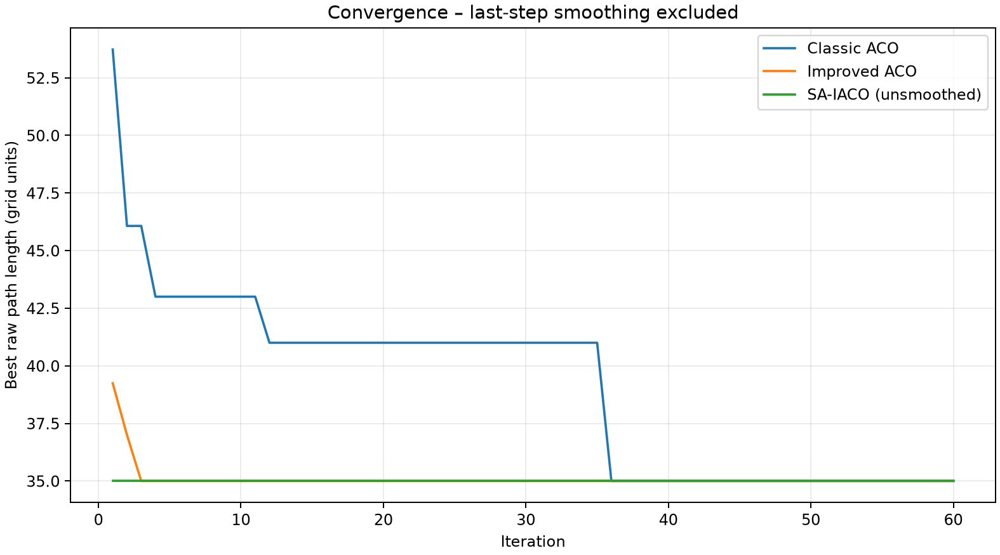
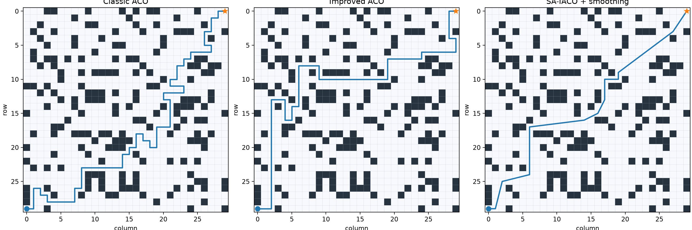
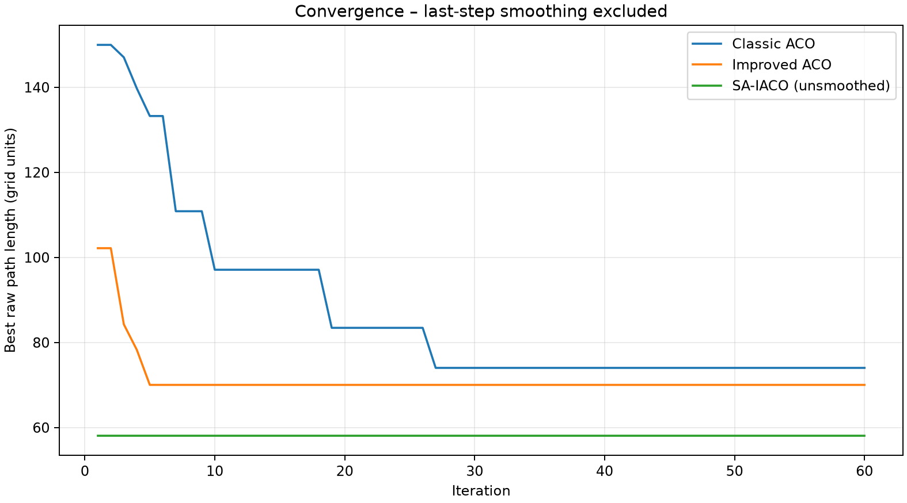

# SAIACO-UGV-Repro

## v0.2.0 — Reproduction audit and paired ablations / 复现审计与配对消融

**Research status / 研究状态:** The algorithm is implemented, but **strict numerical reproduction of the paper has not been achieved**. The figures do not disclose exact obstacle matrices, original endpoints or complete hyperparameters; claims are confined to independently digitized experimental maps. Six additional paper-figure maze *occupancy patterns* have been digitized, but their start and goal are **assumed experimental probes**.

**Reproducibility fixes:** A turning event is now defined by a change of heading, not by raw inequality of segment vectors. This prevents a collinear 2-cell segment followed by a 3-cell segment being counted as a turn. An exact Dijkstra reference for the corner-safe 8-connected graph is provided; its subsequently smoothed path is a **feasible comparison, not a certified continuous-path optimum**.

**Paired 3-seed exploratory study** (12 ants, 20 iterations, same seeds 0/1/2 per condition; lower length is better):

| 20×20 / 30×30 | Full SA-IACO | No SA | No direction | No smoothing |
|---|---:|---:|---:|---:|
| 20×20 mean length | 28.43 | 28.44 | 27.63 | 35.75 |
| 30×30 mean length | 48.41 | 49.37 | 48.39 | 58.08 |



All 6 special maps produced collision-free feasible paths in 3/3 seeds each, on the assumed start/goal probes. These numbers are **not** the original paper's results and the sample size is too small for claims of statistical significance. In both main maps, disabling smoothing caused a large deterioration; current tests did not establish positive added value from directional guidance or SA. The hybrid algorithm's raw search often failed to improve on its A* seed, so more optimization work is needed.

本轮已完成 18 项测试、Dijkstra 图最短路径参照、6 种特殊地图近似提取及 3 随机种子消融实验。**目前的主要性能收益来自路径平滑，尚不能证明模拟退火或方向引导带来稳定增益；不宣称完全数值复现。**

Run / 复现实验：

```bash
python scripts/study_v02.py --seeds 3 --ants 12 --iterations 20
```

Results: [summary.csv](outputs/study_v02/summary.csv), [per-seed runs.csv](outputs/study_v02/runs.csv), [deterministic references](outputs/study_v02/references.json), [map assumptions](docs/map_provenance.md). For a stronger statistical conclusion, increase independent seeds to at least 30 and test on held-out maps without tuning to these results.

---


**Simulated Annealing–Improved Ant Colony Optimization for Unmanned Ground Vehicle Path Planning**  
**基于模拟退火-改进蚁群算法的无人车路径规划——独立复现**

> **Status:** Tested independent implementation. **The paper's numerical results have NOT been exactly reproduced.**  
> **复现状态：** 已完成独立实现、自动化测试及初步基准实验，**尚未严格复现原论文的数值结果**。

## 1. Original paper / 原论文

- **Authors:** 朱梓轩、于莲芝 (Zhu Zixuan, Yu Lianzhi)
- **Journal:** 《电子科技》 / *Electronic Science and Technology*
- **Online first:** 2026-06-11
- **DOI:** https://doi.org/10.16180/j.cnki.issn1007-7820.2027.05.003
- **Reference environment:** MATLAB R2024b
- **This independent implementation:** Python 3.10+ with Matplotlib and pytest

This code is an independent reproduction, **not the authors' official implementation**. The article does not provide original grid matrices or all hyperparameters. See [map provenance and implementation assumptions](docs/map_provenance.md).

本仓库基于论文方法及公式独立实现，非作者官方代码。原文没有完整公开地图矩阵及实验超参数，因此对近似地图、参数假设、安全策略及复现误差单独说明。

## 2. Algorithms / 算法实现

Three experimental modes: **Classic ACO**, **Improved ACO**, and **SA-IACO**.

1. Four-neighbor A* initialization to generate a feasible seed path (section 2.1).
2. ACO pheromone–heuristic transition probability (Eq. 3).
3. Adaptive pheromone and heuristic exponents, alpha and beta (Eq. 9).
4. Direction-aware heuristic to reduce turning (Eqs. 10–12).
5. Weighted objective combining length, turns and curvature variation (Eqs. 13, 15–16).
6. Pheromone clipping and adaptive evaporation (Eqs. 17–18).
7. Simulated-annealing Metropolis acceptance and cooling (Eq. 19).
8. Dynamic-density interpolation and obstacle-safe waypoint removal (Eqs. 20–22).

实现经典蚁群、改进蚁群、模拟退火混合蚁群，包含简化 A* 初始化、动态信息素与启发因子、方向引导、多目标评分、信息素边界控制、Metropolis 准则及自适应密度路径平滑。

### Key equations / 核心公式

Transition probability / 状态转移概率：

$$
P_{ij}^{k}(t)=\frac{\tau_{ij}(t)^{\alpha}\eta_{ij}(t)^{\beta}}{\sum_{s\in allowed_k}\tau_{is}(t)^{\alpha}\eta_{is}(t)^{\beta}}
$$

Multiobjective score / 综合路径评分：

$$
S(k)=\xi L_k+\varphi N_k+\psi H_k
$$

Metropolis probability / 模拟退火接受概率：

$$
P=\exp\left(-\frac{E_{t+1}-E_t}{T}\right)
$$

**Implementation assumption:** ACO traverses eight neighbors without diagonal corner cutting; the seed A* traverses four neighbors. The smoother also uses conservative supercover collision checking. The paper does not fully specify these choices, so they affect numeric comparability.

## 3. Reproduced experiments / 实测结果

Default configuration: **30 ants × 60 iterations, seed 2026**. The `paper20` and `paper30` maps were independently digitized from printed plots, **not supplied as original MATLAB grids**.

### 20×20




| Algorithm | Our length | Our turns | Our smoothness | Paper length | Paper turns | Paper smoothness |
|:--|--:|--:|--:|--:|--:|--:|
| Classic ACO | 35.00 | 19 | 16.00 | 32.00 | 15 | 14.00 |
| Improved ACO | 35.00 | 8 | 13.00 | 32.00 | 9 | 13.41 |
| SA-IACO | **28.47** | **5** | **6.00** | **29.54** | **6** | **5.58** |

### 30×30




| Algorithm | Our length | Our turns | Our smoothness | Paper length | Paper turns | Paper smoothness |
|:--|--:|--:|--:|--:|--:|--:|
| Classic ACO | 74.00 | 44 | 32.00 | 51.40 | 25 | 22.65 |
| Improved ACO | 70.00 | 18 | 27.00 | 50.20 | 15 | 15.94 |
| SA-IACO | **48.39** | **11** | **5.30** | **44.70** | **6** | **0.94** |

Our numbers are **single-seed preliminary experiments**, not the authors' reported performance. In the 30×30 case, the hybrid's final improvement over the A* seed was mostly due to the collision-safe smoothing stage; raw score had not improved.

以上为本仓库真实运行的一次随机种子实验，不能视为原论文数值已完全复现。特别是 30×30 地图的传统与改进 ACO 基线仍与论文相差明显，需通过参数敏感性实验、多种子验证和地图人工复核继续研究。

## 4. Install / 安装和运行

```bash
git clone https://github.com/ZJY-HSBL/SAIACO-UGV-Repro.git
cd SAIACO-UGV-Repro
python -m pip install -e '.[test]'
pytest -q
saiaco-repro --map paper20 --ants 30 --iterations 60 --seed 2026
saiaco-repro --map paper30 --ants 30 --iterations 60 --seed 2026
```

Outputs: `outputs/<map>/paths.png`, `convergence.png`, `metrics.csv`, and `results.json`. GitHub Actions automatically regenerates benchmark artifacts after publishing.

Optional maze simulations: `saiaco-repro --map all --iterations 60 --ants 30 --seed 2026`. The extra U and X maps are illustrative rather than exact digitizations. `--goal-bias` is a clearly marked non-paper extension, default zero.

## 5. Repository layout / 项目结构

```text
src/saiaco_ugv/
  algorithms.py       # Classic ACO / improved ACO / SA-IACO
  grid.py             # Grid and A* / collision geometry
  metrics.py          # Length, turns and curvature variation
  smoothing.py        # Adaptive-density smoothing
  plotting.py         # Map and convergence figures
  cli.py              # Reproducible CLI
  maps/               # Figure-derived and illustrative maps
tests/                 # Automated tests
outputs/               # Experiment JSON, CSV and PNG generated in CI
docs/map_provenance.md # Source/parameter uncertainty
.github/workflows/    # Python CI and benchmark publication
```

## 6. Research roadmap / 后续研究

- 30+ independent random seeds; report confidence intervals and route-success rates.
- Ablations: direction heuristic, alpha/beta schedule, evaporation, SA, smoothing.
- Parameter sensitivity and manual verification of digitized obstacle maps.
- Collision clearance, obstacle-density sweeps and maze failure cases.
- Keep original paper metrics separate from independent empirical results.

**License:** MIT applies to independently written code only; copyright in the original paper and figures belongs to their respective owners.
